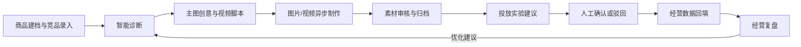

# 电商运营助手

面向电商运营团队的智能运营工作台，围绕单品经营全生命周期，连接商品建档、竞品分析、AI 诊断与创意、异步素材制作、人工投放决策、经营数据回填和复盘。

> **当前交付：Issue #1 工程基线。** 已提供 Web、API、MySQL、Redis、Celery Worker 和数据库迁移入口。页面展示真实服务连接状态；登录、商品和 AI 业务功能将按后续 Issues 实现。

## 本机启动

需要 Docker Desktop（Linux 容器）和 Docker Compose v2。以下命令在代码仓库根目录执行，即本机的 `ecommerce_operation_assistant/code`：

```powershell
.\scripts\init-env.ps1
docker compose up --build -d --wait --wait-timeout 180
docker compose ps -a
.\scripts\smoke.ps1
```

初始化脚本从 `.env.example` 生成被 Git 忽略的 `.env`，随机创建本机数据库密码；已有 `.env` 不会被覆盖。工程基线不需要模型密钥。若 PowerShell 提示不允许运行本地脚本，可以在当前终端执行 `Set-ExecutionPolicy -Scope Process Bypass` 后重试。

启动后访问：

| 入口 | 默认地址 | 作用 |
| --- | --- | --- |
| 运营大盘 | http://localhost:3000 | 查看实际连接状态并点击“重新检查” |
| Web 存活检查 | http://localhost:3000/health | 检查 Next.js 服务是否存活 |
| Web → API 检查 | http://localhost:3000/api/health | 经 Web 服务访问 API 就绪检查 |
| API 存活检查 | http://localhost:8000/health/live | 独立于数据库的进程状态 |
| API 就绪检查 | http://localhost:8000/health/ready | 检查 MySQL、Redis 和素材卷；异常返回 HTTP 503 |
| API 文档 | http://localhost:8000/docs | 查看当前可用接口 |

`migrate` 容器完成迁移后以状态码 0 退出，属于正常状态；其他五个服务应为运行且健康。`smoke.ps1` 同时验证数据库迁移版本及 API → Redis → Worker → 结果队列的真实执行链路。数据库和 Redis 仅向容器网络开放，Web/API 仅绑定本机回环地址。

初次启动需要下载镜像和依赖；可在 `.env` 修改 `WEB_PORT` 或 `API_PORT` 避免端口占用，然后重新执行启动命令。若连接异常，使用下列命令定位：

```powershell
docker compose logs --tail 100 api worker migrate
docker compose restart api worker
```

停止服务使用 `docker compose down`，MySQL、Redis 和素材卷会保留。保留数据卷期间不要重新生成数据库密码；变更应用连接配置不会自动修改已有数据库账号密码。工程阶段的迁移只建立 Alembic 版本记录，业务表在后续任务中加入。

## 工程目录

目录分层参考参考项目的 `api`/`web` 组织方式：

```text
api/
  app/
    api/routes/      # HTTP 路由
    core/            # 环境配置
    db/              # Base 导出、连接池、请求级会话
    services/        # 基础设施检查与后续业务服务
    worker/          # Celery 应用与任务
    models.py        # 统一 ORM 元数据，后续增加业务模型
    observability.py # 结构化日志
  alembic/           # 版本化迁移
  tests/             # 隔离的自动化检查
web/
  src/app/           # Next.js App Router 页面与服务端路由
  src/components/    # 界面组件
  src/lib/           # 服务端 API 访问等基础方法
scripts/             # 本机初始化、检查、容器验收脚本
compose.yaml         # 单机服务与持久化卷
```

数据库沿用参考项目的 SQLAlchemy 同步会话、`pool_pre_ping`、连接回收和 Alembic 迁移方式；密码从环境读取，SQL 参数隐藏。应用服务使用非 root 数据库账号，Web 不读取数据库或模型密钥。

## 项目目标

把分散在商品资料、内容制作、投放建议和经营结果中的信息关联到同一商品，让运营团队可以追踪每次行动的依据与结果，并将复盘建议带入下一轮运营。

## 业务流程



## 规划功能

### 首期 P0

- 多店铺、商品、SKU、库存流水和库存预警
- 竞品资料录入与商品对标
- 结构化商品诊断：目标客群、价格带、卖点矩阵、转化卡点和优化方向
- 每次至少生成 3 组主图创意和 3 套视频分镜脚本，支持编辑、确认和归档
- 图片/视频异步任务：状态追踪、超时处理、重试与取消
- 商品素材库：来源任务追踪、版本查看、审核、打标和归档
- 投放实验建议与普通/高风险人工审批
- 经营数据录入、目标与实际比较、单品复盘及下一轮诊断入口
- 商品、库存和经营数据的 Excel/CSV 导入预览与确认
- 系统服务配置、平台授权状态占位和任务规则配置

### 后续阶段

- **P1：** 单品 Agent 任务、受控工具、人工审批与恢复；竞品公开链接解析及周期对比；经营趋势图表。
- **P2：** 素材版本比较增强；无线充热销款防守示例场景。

## 技术方案

当前设计采用前后端分离的模块化单体，并将耗时媒体任务交给异步 Worker：

| 层 | 规划技术 | 用途 |
| --- | --- | --- |
| Web 前端 | Next.js、React、TypeScript | 运营大盘、商品工作台、导入中心、系统配置 |
| API 服务 | Python、FastAPI、Pydantic | 业务 API、权限校验、结构化内容与导入校验 |
| 数据库 | MySQL、SQLAlchemy、Alembic | 业务数据、事务和数据库迁移 |
| 异步任务 | Redis、Celery | 图片/视频任务队列、重试和后台处理 |
| 文件存储 | 开发阶段使用受控本地卷 | 导入文件和生成素材；部署方案确定后再评估共享存储 |

当前仅实现工程与连接基线；表中的商品、导入和 AI 业务能力属于后续规划。

## 角色与权限

| 角色 | 主要职责 |
| --- | --- |
| 运营人员 | 维护商品与竞品、生成和编辑内容、审核素材、处理普通投放建议、录入数据及查看复盘 |
| 运营主管 | 执行运营工作，并确认或驳回高风险投放建议 |
| 管理员 | 管理服务配置、任务规则和平台授权状态，并处理高风险投放建议 |

## 安全与决策边界

- 投放建议只供人工决策；系统不自动创建外部广告计划，也不自动扣费。
- 平台账号只保存接入标识和脱敏授权状态，不保存明文密码或 Cookie。
- 模型与视频服务密钥从运行环境配置；不能在界面或日志中明文回显。
- AI 生成内容必须可编辑；后续生成不能覆盖已确认的人工修改版本。
- 失败或超时的媒体任务不能被当作可用素材。
- 示例经营数据需明确标记为演示数据，并与真实经营数据区分。

## 迭代路线

1. 工程基线与本机健康检查
2. 认证、权限、商品数据和运营工作台
3. AI 诊断、创意、异步素材任务与素材审核
4. 投放审批、经营数据回填与复盘闭环
5. 导入、系统配置、防晒衣示例和 P0 交付验收
6. P1 Agent 与业务增强，之后再按优先级推进 P2

## 文档与设计

PRD、Spec、UI 预览与实施计划保留在代码仓库外的本地工作区。开发任务与阶段验收通过 GitHub Issues 跟踪。

## 开发与贡献

后端由 **uv** 管理：`api/pyproject.toml` 声明依赖，`api/uv.lock` 锁定完整依赖，`api/.python-version` 指定 Python 3.12。前端的 JavaScript 依赖由 npm 和 `web/package-lock.json` 管理。

本地检查需要 uv 和 Node.js 22+（推荐 24）；uv 可按 `.python-version` 准备 Python 环境。Windows PowerShell 执行：

```powershell
.\scripts\check.ps1
```

脚本安装锁定依赖，依次执行 Ruff、后端测试、ESLint、TypeScript 和 Next.js 构建。依赖已安装时可以加 `-SkipInstall`。运行中的容器另用 `smoke.ps1` 验收。

常用后端命令（在代码仓库根目录执行）：

```powershell
uv sync --project api --locked
uv run --project api --locked pytest api/tests -q
uv add --project api <依赖包名>
uv add --project api --dev <开发依赖包名>
```

修改依赖后提交 `pyproject.toml` 和 `uv.lock`；不提交 `.venv`。API 镜像使用固定版本 uv 执行 `uv sync --locked --no-dev`，启动命令运行同一虚拟环境中的 Uvicorn、Alembic 和 Celery。

## 本地镜像管理

运行镜像为 MySQL、Redis、API/Worker 共用镜像和 Web 镜像；构建还需要 Python、Node.js 和固定版本 uv 基础镜像。参考项目也将 API、Worker 和 Web 放入 Docker；Agent 的 PostgreSQL 留在后续阶段加入。

镜像归档默认放在代码仓库外的 `../镜像/`（当前工作区为 `D:\AgentDevelopmentProject\ecommerce_operation_assistant\镜像`），不进入 Git：

```powershell
.\scripts\export-images.ps1
.\scripts\import-images.ps1
```

导出脚本从 Compose 和 Dockerfile 收集所需镜像，生成归档及 `镜像清单.json`，记录镜像 ID、用途和归档 SHA256；导入脚本先验证哈希，加载后再核对镜像 ID。两个脚本也支持自定义 `-OutputDirectory` 或 `-InputDirectory`。

已有完整归档时，可以在导入并初始化本机 `.env` 后使用 `docker compose up -d --no-build --pull never --wait --wait-timeout 180` 启动。归档不包含数据库数据卷、素材内容或 `.env`，也不保证能在断网状态重新构建包依赖。镜像需要由 Docker 加载到引擎才能运行，文件夹用于归档和迁移。

在功能分支上完成 Issue，通过检查后创建关联 PR；项目负责人评审并合并。Issue #1 完成不代表 M1 整体完成，登录和权限需由 Issue #2 继续交付。
