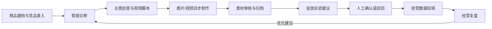

# 电商运营助手

面向电商运营团队的智能运营工作台，围绕单品经营全生命周期，连接商品建档、竞品分析、AI 诊断与创意、异步素材制作、人工投放决策、经营数据回填和复盘。

> **项目状态：规划与工程初始化阶段。** 当前仓库只有项目说明文件，应用功能尚未实现，暂时没有可用的安装、启动或演示命令。工程基线完成后会在此补充实际运行步骤。

## 项目目标

把分散在商品资料、内容制作、投放建议和经营结果中的信息关联到同一商品，让运营团队可以追踪每次行动的依据与结果，并将复盘建议带入下一轮运营。

## 业务流程

## 规划功能

### 首期 P0

- 多店铺、商品、SKU、库存流水和库存预警
- 竞品资料录入与商品对标
- 结构化商品诊断：目标客群、价格带、卖点矩阵、转化卡点和优化方向
- 每次至少生成 3 组主图创意和 3 套视频分镜脚本，支持编辑、确认和归档
- 图片/视频异步任务：状态追踪、超时处理、重试与取消
- 商品素材库：来源任务追踪、版本查看、审核、打标和归档
- 投放实验建议与普通/高风险人工审批
- 经营数据录入、目标与实际比较、单品复盘及下一轮诊断入口
- 商品、库存和经营数据的 Excel/CSV 导入预览与确认
- 系统服务配置、平台授权状态占位和任务规则配置

### 后续阶段

- **P1：** 单品 Agent 任务、受控工具、人工审批与恢复；竞品公开链接解析及周期对比；经营趋势图表。
- **P2：** 素材版本比较增强；无线充热销款防守示例场景。

## 技术方案

当前设计采用前后端分离的模块化单体，并将耗时媒体任务交给异步 Worker：

| 层 | 规划技术 | 用途 |
| --- | --- | --- |
| Web 前端 | Next.js、React、TypeScript | 运营大盘、商品工作台、导入中心、系统配置 |
| API 服务 | Python、FastAPI、Pydantic | 业务 API、权限校验、结构化内容与导入校验 |
| 数据库 | MySQL、SQLAlchemy、Alembic | 业务数据、事务和数据库迁移 |
| 异步任务 | Redis、Celery | 图片/视频任务队列、重试和后台处理 |
| 文件存储 | 开发阶段使用受控本地卷 | 导入文件和生成素材；部署方案确定后再评估共享存储 |

以上是设计基线，不表示这些组件已在当前仓库中实现或配置完成。

## 角色与权限

| 角色 | 主要职责 |
| --- | --- |
| 运营人员 | 维护商品与竞品、生成和编辑内容、审核素材、处理普通投放建议、录入数据及查看复盘 |
| 运营主管 | 执行运营工作，并确认或驳回高风险投放建议 |
| 管理员 | 管理服务配置、任务规则和平台授权状态，并处理高风险投放建议 |

## 安全与决策边界

- 投放建议只供人工决策；系统不自动创建外部广告计划，也不自动扣费。
- 平台账号只保存接入标识和脱敏授权状态，不保存明文密码或 Cookie。
- 模型与视频服务密钥从运行环境配置；不能在界面或日志中明文回显。
- AI 生成内容必须可编辑；后续生成不能覆盖已确认的人工修改版本。
- 失败或超时的媒体任务不能被当作可用素材。
- 示例经营数据需明确标记为演示数据，并与真实经营数据区分。

## 迭代路线

1. 工程基线与本机健康检查
2. 认证、权限、商品数据和运营工作台
3. AI 诊断、创意、异步素材任务与素材审核
4. 投放审批、经营数据回填与复盘闭环
5. 导入、系统配置、防晒衣示例和 P0 交付验收
6. P1 Agent 与业务增强，之后再按优先级推进 P2

## 文档与设计

产品需求、技术设计和 UI 预览目前维护在项目工作区中：`PRD.md`、`SPEC.md` 与 `ui.pen`。后续可随项目代码一并纳入仓库，保持文档与实现同步。

## 开发与贡献

项目处于初始化阶段，尚未形成稳定的本地开发命令或贡献流程。相关命令、环境变量说明、数据库初始化、代码规范和检查方式会随工程基线实现后补充。开始贡献前，请先在 GitHub Issues 中确认任务范围和验收条件；代码改动通过 Pull Request 评审后合并。
