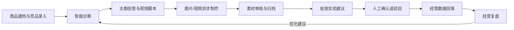

# 电商运营助手

面向电商运营团队的智能运营工作台，围绕单品经营全生命周期，连接商品建档、竞品分析、AI 诊断与创意、异步素材制作、人工投放决策、经营数据回填和复盘。

> **当前开发：M9 P0 完整演示、异常回归与容器交付（Issue #15）。** M1—M8 的业务能力已完成，当前阶段聚焦可复现启动、P0 全流程回归和交接记录。

## 本机启动

需要 Docker Desktop（Linux 容器）和 Docker Compose v2。以下命令在代码仓库根目录执行，即本机的 `ecommerce_operation_assistant/code`：

```powershell
.\scripts\init-env.ps1
docker compose up --build -d --wait --wait-timeout 180
docker compose ps -a
.\scripts\smoke.ps1
```

初始化脚本从 `.env.example` 生成被 Git 忽略的 `.env`，随机创建数据库密码和认证令牌签名密钥；已有 `.env` 不会被覆盖。首次启动后，在另一个 PowerShell 窗口初始化管理员：

```powershell
docker compose exec api python -m app.bootstrap
```

按提示输入管理员邮箱、名称和至少 12 位密码。密码不会回显或保存在仓库中。若 PowerShell 提示不允许运行本地脚本，可以在当前终端执行 `Set-ExecutionPolicy -Scope Process Bypass` 后重试。

启动后访问：

| 入口 | 默认地址 | 作用 |
| --- | --- | --- |
| 运营大盘 | http://localhost:3000 | 登录后创建店铺和商品、检索商品并查看库存预警 |
| 商品工作台总览 | http://localhost:3000/products | 按商品名称或 SKU 检索，筛选店铺、平台和库存状态，进入单品工作台 |
| 模型与服务配置 | http://localhost:3000/settings | 管理员查看服务状态、配置任务规则和平台授权占位 |
| 登录页 | http://localhost:3000/login | 使用初始化的管理员账号登录 |
| Web 存活检查 | http://localhost:3000/health | 检查 Next.js 服务是否存活 |
| Web → API 检查 | http://localhost:3000/api/health | 经 Web 服务访问 API 就绪检查 |
| API 存活检查 | http://localhost:8000/health/live | 独立于数据库的进程状态 |
| API 就绪检查 | http://localhost:8000/health/ready | 检查 MySQL、Redis 和素材卷；异常返回 HTTP 503 |
| API 文档 | http://localhost:8000/docs | 查看当前可用接口 |

认证接口为 `POST /api/v1/auth/login`、`GET /api/v1/auth/me` 和 `GET /api/v1/auth/workspaces`。认证采用短期 Bearer 令牌；Web 将令牌保存在 HttpOnly Cookie 中，浏览器脚本不能读取令牌。跨工作空间访问由 API 根据用户成员关系和 `X-Workspace-ID` 校验。

工作空间管理员可调用 `POST /api/v1/auth/workspaces/{workspace_id}/members` 添加运营人员、主管或管理员，提交时需同时提供 Bearer 令牌和 `X-Workspace-ID`。添加成员和角色会写入 `audit_events`；后续配置接口应使用管理员权限依赖，高风险审批接口应使用主管/管理员权限依赖。

### M2 商品建档与库存

登录后先在运营大盘新建店铺，再新建商品。顶部“商品工作台”进入独立商品池页面；首页商品列表仍可直接进入单品。商品池可按名称或 SKU 检索，并按店铺、平台、库存状态筛选；显示 SKU 数、售价区间、库存预警和档案待完善数量。单品档案可填写平台商品编号、成本、目标人群与核心卖点。进入单品后可录入不同规格的 SKU、价格和初始库存；每次库存调整都需要填写原因，并生成可查询的库存流水。SKU 库存低于预警阈值时，大盘和商品池会显示预警。竞品资料按当前商品保存名称、价格和关键参数；切换商品后只显示该商品的数据。诊断、创意、异步媒体、投放审批和经营复盘已分别在后续页面提供。

商品 API 位于 `/api/v1/catalog`，包括 `stores`、`products`、`products/{id}/skus`、`products/{id}/inventory-movements`、`products/{id}/competitors` 和 `dashboard`。请求需带 Bearer 令牌及 `X-Workspace-ID`；商品列表支持 `q`（名称或 SKU）、`store_id`、`platform`、`stock_status`、`profile_incomplete`、`sort`、`page` 和 `page_size`。Web 页面经同源 `/api/catalog/` 代理调用。库存调整接口接收调整后的绝对数量 `quantity` 和原因 `reason`。店铺、商品和 SKU 的删除接口执行归档，保留历史记录。

### M3 服务配置与任务规则

管理员通过“模型配置”进入独立页面，可为文字、图片和视频服务保存供应商与模型名称，查看环境密钥是否存在，维护任务超时、重试、并发和轮询参数，并为店铺记录平台账号标识及授权占位状态。所有修改及连接检查写入当前工作空间的配置审计。运营人员不能读取或修改配置，跨工作空间数据由 API 权限校验隔离。

服务密钥只从 `api` 和 `worker` 容器的运行环境读取。将 `OPENAI_API_KEY`、`OPENAI_TEXT_MODEL`、`OPENAI_IMAGE_MODEL` 以及可选的 `VIDEO_PROVIDER`、`VIDEO_API_KEY`、`VIDEO_MODEL` 写入被 Git 忽略的 `.env`，再执行 `docker compose up -d --build --wait --wait-timeout 180` 重建服务。数据库、Web 响应和审计日志均不保存密钥；页面只显示“已配置/未配置”。不要在平台账号标识中填写密码、Cookie 或令牌，接口也拒绝这些额外字段。

文字和图片的“检查连接”会读取 OpenAI 模型元数据，不调用生成接口；成功只证明当前密钥可以读取该模型元数据，不保证生成权限或额度。连接检查可能产生供应商 API 请求。未配置时返回明确提示；视频供应商检查尚未接入，会显示“不支持”，不会将密钥存在误报为连接成功。配置 API 位于 `/api/v1/settings`，Web 经同源 `/api/settings/` 代理访问。

### M4 诊断与内容创意

打开商品工作台的“智能诊断与创意”分区后，系统会把当前商品档案、SKU 和竞品资料作为上下文提交给文本 Provider。诊断必须返回目标客群、价格带、卖点矩阵、转化卡点和优化方向；主图创意一次返回 3 组版式/文案/卖点/视觉建议；视频脚本一次返回 3 套 3 秒钩子、分镜画面、口播和促单话术。每个结果都保存为商品范围内的版本，可编辑为人工内容、确认、归档并查看状态。

编辑接口要求携带读取时的 `revision`。两个页面同时编辑时，旧 revision 会得到冲突提示；已确认版本不能直接覆盖，重新生成会创建新草稿。模型未配置、商品资料不完整或供应商失败时，已有版本保留且页面显示可理解的错误。

### M5 异步媒体任务与素材库

只能从已确认的主图创意或视频脚本发起任务。接口立即返回 `pending`，Worker 负责执行并追加事件时间线；任务使用工作空间级幂等键，支持查询、取消、失败或超时重试。成功产物会关联商品、内容版本和生成任务，进入素材库后可由主管或管理员审核、打标签和归档。Provider 密钥只从环境读取，未配置或供应商失败时返回安全错误，并且不会创建可用素材。

主要接口位于 `/api/v1/media`：`products/{id}/jobs`、`jobs/{id}`、`jobs/{id}/cancel`、`jobs/{id}/retry`、`products/{id}/assets`、`assets/{id}`。Web 经同源 `/api/media/` 代理访问。

### M8 批量导入中心

“导入中心”支持商品、SKU/库存和经营数据三类 CSV/XLSX 模板。上传后先生成带行号、字段和错误原因的预览批次，预览不会写入业务表；用户确认后只提交有效行。批次带工作空间归属和版本号，重复提交或过期提交会被拒绝。接口位于 `/api/v1/imports`，Web 页面为 `/imports`。

### M9 P0 交付验收

M9 提供 `scripts/p0-regression.ps1` 作为可重复的交付回归入口，覆盖 API/Web 健康检查、匿名访问保护、管理员登录、运营大盘、商品工作台、模型配置、导入中心、退出登录，以及数据库迁移和 Worker 往返任务。完整的 P0 人工验收清单见 [`docs/M9-P0验收记录.md`](docs/M9-P0验收记录.md)。

```powershell
docker compose up --build -d --wait --wait-timeout 180
.\scripts\p0-regression.ps1 -ReportPath .\reports\m9-p0-regression.json
```

需要检查登录后的页面时，将 `Get-Credential` 返回的管理员凭据通过 `-Credential` 传入。回归报告只保存检查结果，`reports/` 已加入 Git 忽略。

### M6/M7 投放审批与经营复盘

投放建议仅保存人群、出价思路、素材组合和 A/B 实验方案，不调用外部广告接口。普通建议可由运营人员确认或驳回，高风险建议必须由主管或管理员处理；风险调整、审批人、角色、备注和时间均写入审计记录。经营数据按商品、日期周期和来源保存目标与实际 GMV、曝光、点击率、转化率和 ROI；复盘报告汇总商品全景、已确认诊断、已审核素材、已处理投放建议及指标差异，并可将行动项关联到下一轮诊断。接口位于 `/api/v1/campaigns` 和 `/api/v1/review`。

`migrate` 容器完成迁移后以状态码 0 退出，属于正常状态；其他五个服务应为运行且健康。`smoke.ps1` 验证匿名访问保护、数据库迁移版本及 API → Redis → Worker → 结果队列的真实执行链路。若要同时验收登录、大盘与退出，在管理员初始化后执行以下命令，并在系统提示时输入账号密码；凭据不会写入仓库：

```powershell
$credential = Get-Credential -Message '输入管理员账号和密码'
.\scripts\smoke.ps1 -Credential $credential
```

数据库和 Redis 仅向容器网络开放，Web/API 仅绑定本机回环地址。

初次启动需要下载镜像和依赖；可在 `.env` 修改 `WEB_PORT` 或 `API_PORT` 避免端口占用，然后重新执行启动命令。若连接异常，使用下列命令定位：

```powershell
docker compose logs --tail 100 api worker migrate
docker compose restart api worker
```

停止服务使用 `docker compose down`，MySQL、Redis 和素材卷会保留。保留数据卷期间不要重新生成数据库密码；变更应用连接配置不会自动修改已有数据库账号密码。迁移会创建用户、工作空间、成员关系、审计表和商品主数据表；首次创建管理员仅可在系统中尚无用户时执行。

## 工程目录

目录分层参考参考项目的 `api`/`web` 组织方式：

```text
api/
  app/
    api/routes/      # HTTP 路由
    core/            # 环境配置
    schemas/         # API 请求与响应模型
    db/              # Base 导出、连接池、请求级会话
    services/        # 认证、密码校验、工作空间和审计逻辑
    worker/          # Celery 应用与任务
    models.py        # 用户、工作空间、审计及商品主数据 ORM 模型
    observability.py # 结构化日志
  alembic/           # 版本化迁移
  tests/             # 隔离的自动化检查
web/
  src/app/           # Next.js App Router 页面与服务端路由
  src/components/    # 界面组件
  src/lib/           # 服务端 API 访问等基础方法
scripts/             # 本机初始化、检查、容器验收脚本
docs/                # 交付回归和人工验收记录
compose.yaml         # 单机服务与持久化卷
```

数据库沿用参考项目的 SQLAlchemy 同步会话、`pool_pre_ping`、连接回收和 Alembic 迁移方式；密码从环境读取，SQL 参数隐藏。应用服务使用非 root 数据库账号，Web 不读取数据库或模型密钥。

## 项目目标

把分散在商品资料、内容制作、投放建议和经营结果中的信息关联到同一商品，让运营团队可以追踪每次行动的依据与结果，并将复盘建议带入下一轮运营。

## 业务流程



## 规划功能

### 首期 P0

- 多店铺、商品、SKU、库存流水和库存预警
- 竞品资料录入与商品对标
- 结构化商品诊断：目标客群、价格带、卖点矩阵、转化卡点和优化方向
- 每次至少生成 3 组主图创意和 3 套视频分镜脚本，支持编辑、确认和归档
- 图片/视频异步任务：状态追踪、超时处理、重试与取消
- 商品素材库：来源任务追踪、版本查看、审核、打标和归档
- 投放实验建议与普通/高风险人工审批
- 经营数据录入、目标与实际比较、单品复盘及下一轮诊断入口
- 商品、库存和经营数据的 Excel/CSV 导入预览与确认
- 系统服务配置、平台授权状态占位和任务规则配置

### 后续阶段

- **P1：** 单品 Agent 任务、受控工具、人工审批与恢复；竞品公开链接解析及周期对比；经营趋势图表。
- **P2：** 素材版本比较增强；无线充热销款防守示例场景。

## 技术方案

当前设计采用前后端分离的模块化单体，并将耗时媒体任务交给异步 Worker：

| 层 | 规划技术 | 用途 |
| --- | --- | --- |
| Web 前端 | Next.js、React、TypeScript | 运营大盘、商品工作台、导入中心、系统配置 |
| API 服务 | Python、FastAPI、Pydantic | 业务 API、权限校验、结构化内容与导入校验 |
| 数据库 | MySQL、SQLAlchemy、Alembic | 业务数据、事务和数据库迁移 |
| 异步任务 | Redis、Celery | 图片/视频任务队列、重试和后台处理 |
| 文件存储 | 开发阶段使用受控本地卷 | 导入文件和生成素材；部署方案确定后再评估共享存储 |

当前已实现工程连接基线、基础认证、M2—M8 业务能力及 M9 交付回归入口；M10 Agent 任务与人工审批恢复仍属于后续阶段。

## 角色与权限

| 角色 | 主要职责 |
| --- | --- |
| 运营人员 | 维护商品与竞品、生成和编辑内容、审核素材、处理普通投放建议、录入数据及查看复盘 |
| 运营主管 | 执行运营工作，并确认或驳回高风险投放建议 |
| 管理员 | 管理服务配置、任务规则和平台授权状态，并处理高风险投放建议 |

## 安全与决策边界

- 投放建议只供人工决策；系统不自动创建外部广告计划，也不自动扣费。
- 平台账号只保存接入标识和脱敏授权状态，不保存明文密码或 Cookie。
- 模型与视频服务密钥从运行环境配置；不能在界面或日志中明文回显。
- AI 生成内容必须可编辑；后续生成不能覆盖已确认的人工修改版本。
- 失败或超时的媒体任务不能被当作可用素材。
- 示例经营数据需明确标记为演示数据，并与真实经营数据区分。

## 迭代路线

1. 工程基线与本机健康检查
2. 认证、权限、商品数据和运营工作台
3. AI 诊断、创意、异步素材任务与素材审核
4. 投放审批、经营数据回填与复盘闭环
5. 导入、系统配置、防晒衣示例和 P0 交付验收
6. P1 Agent 与业务增强，之后再按优先级推进 P2

## 文档与设计

PRD、Spec、UI 预览与实施计划保留在代码仓库外的本地工作区。开发任务与阶段验收通过 GitHub Issues 跟踪。

## 开发与贡献

后端由 **uv** 管理：`api/pyproject.toml` 声明依赖，`api/uv.lock` 锁定完整依赖，`api/.python-version` 指定 Python 3.12。前端的 JavaScript 依赖由 npm 和 `web/package-lock.json` 管理。

本地检查需要 uv 和 Node.js 22+（推荐 24）；uv 可按 `.python-version` 准备 Python 环境。Windows PowerShell 执行：

```powershell
.\scripts\check.ps1
```

脚本安装锁定依赖，依次执行 Ruff、后端测试、ESLint、TypeScript 和 Next.js 构建。依赖已安装时可以加 `-SkipInstall`。运行中的容器另用 `smoke.ps1` 验收。

常用后端命令（在代码仓库根目录执行）：

```powershell
uv sync --project api --locked
uv run --project api --locked pytest api/tests -q
uv add --project api <依赖包名>
uv add --project api --dev <开发依赖包名>
```

修改依赖后提交 `pyproject.toml` 和 `uv.lock`；不提交 `.venv`。API 镜像使用固定版本 uv 执行 `uv sync --locked --no-dev`，启动命令运行同一虚拟环境中的 Uvicorn、Alembic 和 Celery。

## 本地镜像管理

运行镜像为 MySQL、Redis、API/Worker 共用镜像和 Web 镜像；构建还需要 Python、Node.js 和固定版本 uv 基础镜像。参考项目也将 API、Worker 和 Web 放入 Docker；Agent 的 PostgreSQL 留在后续阶段加入。

镜像归档默认放在代码仓库外的 `../镜像/`（当前工作区为 `D:\AgentDevelopmentProject\ecommerce_operation_assistant\镜像`），不进入 Git：

```powershell
.\scripts\export-images.ps1
.\scripts\import-images.ps1
```

导出脚本从 Compose 和 Dockerfile 收集所需镜像，生成归档及 `镜像清单.json`，记录镜像 ID、用途和归档 SHA256；导入脚本先验证哈希，加载后再核对镜像 ID。两个脚本也支持自定义 `-OutputDirectory` 或 `-InputDirectory`。

已有完整归档时，可以在导入并初始化本机 `.env` 后使用 `docker compose up -d --no-build --pull never --wait --wait-timeout 180` 启动。归档不包含数据库数据卷、素材内容或 `.env`，也不保证能在断网状态重新构建包依赖。镜像需要由 Docker 加载到引擎才能运行，文件夹用于归档和迁移。

在功能分支上完成 Issue，通过检查后创建关联 PR；项目负责人评审并合并。M2 包含 Issue #3、#4，两项验收共同构成商品与运营大盘的阶段交付。
