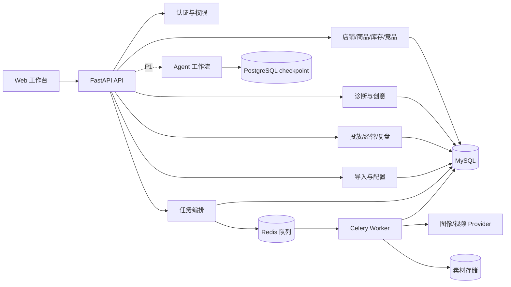
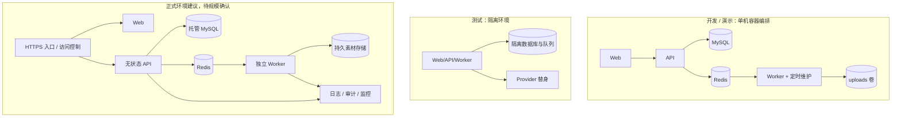
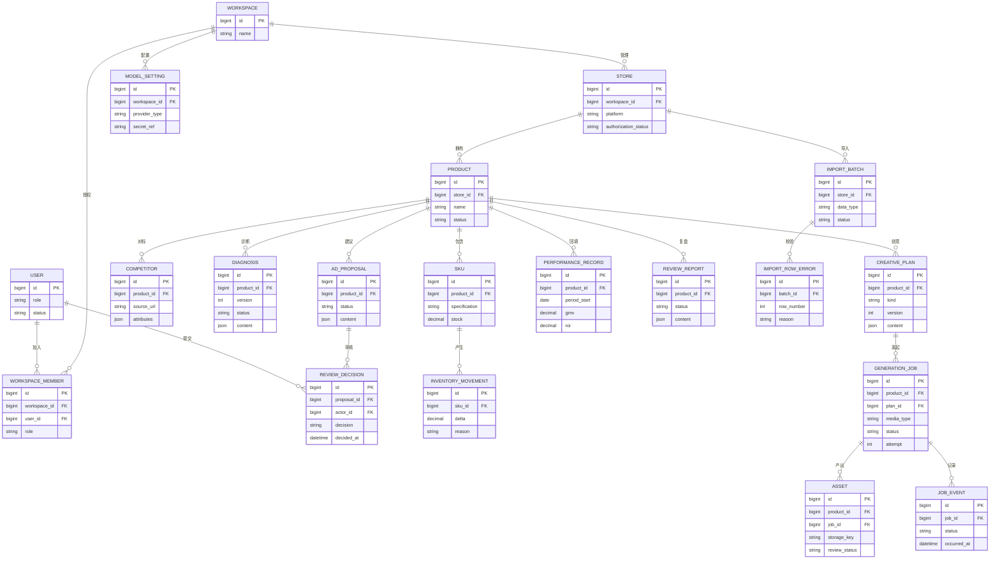

# 电商运营助手技术设计规格说明书（Spec）

| 项目 | 内容 |
| --- | --- |
| 文档名称 | 电商运营助手技术设计规格说明书 |
| 版本 | v0.2 |
| 架构师角色 | 技术方案整理 |
| 日期 | 2026-10-15 |
| 状态 | 草稿，待用户评审 |
| 依据 PRD | [PRD v0.3](../requirements/PRD.md) |
| 设计基线 | 参考项目的前后端分离、业务模块、异步任务和容器交付方式；按本项目 PRD 收敛首期范围 |

> **维护说明：** 本文保留 2026-10-15 的 Spec v0.2 设计基线及当时记录的评审状态，不代表所有计划技术均已进入当前运行栈。实际部署拓扑、数据库、密钥处理和未实现的外部 Provider 边界，须同时阅读[实现状态说明](../实现状态说明.md)与仓库根目录的 [README.md](../../README.md)。

本文的“首期”指 PRD 的 P0 完整演示链路。平台授权占位、风险人工标记、有效行导入和本机容器演示已依据参考源码与用户确认确定。视频供应商的最终选择、正式性能环境及 Agent 阶段的细项仍待后续审查。

## 1. 架构设计概述

采用**前后端分离的模块化单体 + 异步 Worker**：一个 Web 工作台负责交互，一个 FastAPI 应用按业务域分层提供 API；耗时的图片、视频任务由队列与 Worker 执行，MySQL 保存业务状态，Redis 承担消息队列。首期以商品为聚合入口，所有记录通过商品标识关联。

选择这一结构，是因为 PRD 的建档、诊断、创意、素材、投放和复盘需要共享商品上下文与事务边界，且参考项目已有相近的模块划分。模块化单体便于逐步学习与联调；把媒体任务独立给 Worker，可避免长耗时调用占用请求线程。代价是 API 和业务模块需严格保持边界，未来独立扩容时要拆分共享数据访问。

首期不把独立多 Agent 平台作为 P0 前置条件。参考源码确实包含该平台，因此将其列为后续计划实现的 P1 阶段：先完成单品闭环，再接入受控工具、Agent 任务、人工审批、恢复与 checkpoint，并复用现有商品归属和审计边界。

## 2. 技术栈与依赖

| 层 | 选型 | 来源与用途 |
| --- | --- | --- |
| 前端 | Next.js、React、TypeScript | 参考项目已有；构建大盘、商品工作台、导入中心与配置页。 |
| API | Python、FastAPI、Pydantic | 参考项目已有；REST API、请求校验与接口文档。 |
| 业务数据 | MySQL、SQLAlchemy、Alembic | 参考项目已有；业务持久化、事务、结构迁移。 |
| 异步任务 | Redis、Celery Worker | 参考项目已有；生成任务入队、执行、重试和维护扫描。 |
| 文件 | 开发/演示使用受控本地卷 | 参考项目 uploads 模式；正式环境若需多实例，建议替换为对象存储。 |
| 表格解析 | CSV 标准解析与 Excel 解析库 | CSV 沿用参考模式；Excel 为本 PRD 增量，具体库在实现时锁定。 |
| 文本与图像 | OpenAI 官方 API 的文本与 GPT Image 接口 | 用户自行在环境变量配置官方 API Key；文本和生图分别指定可用模型，后端保存图像结果。实际访问权限与额度以用户账号为准。 |
| 视频 | 即梦或 DashScope Provider 适配接口 | 沿用参考源码的供应商边界，用户随后配置对应密钥；不能复用 OpenAI 官方 API Key 作为视频接口。 |
| Agent 阶段 | LangGraph、PostgreSQL checkpoint | 参考源码已有；在 P0 单品闭环后接入任务编排、人工中断与恢复。 |
| 可观测 | 结构化日志、任务事件；可选 OpenTelemetry | 参考项目已有观测基础，用于关联请求、任务和失败原因。 |

这些是**基于参考项目并结合用户已确认的 OpenAI 官方 Key 作出的设计选择**，不是框架版本承诺。依赖版本在实施时锁定并通过构建与回归测试验证。OpenAI 官方[图像生成接口](https://developers.openai.com/api/reference/resources/images/methods/generate)支持 GPT Image 模型；官方[停用公告](https://developers.openai.com/api/docs/deprecations)列明原 Videos API 已于 2026-09-24 下线。LangGraph 与 PostgreSQL checkpoint 属于后续 Agent 阶段，不进入首期必需部署。

本机 `.env` 约定预留 `OPENAI_API_KEY`、`OPENAI_TEXT_MODEL`、`OPENAI_IMAGE_MODEL`，以及独立的 `VIDEO_PROVIDER`、`VIDEO_API_KEY`、`VIDEO_MODEL`。图片调用 OpenAI 图像生成接口并把返回的图像数据保存为商品素材；文本模型的 Key 不能替代图像模型访问权限。视频 Provider 在即梦与 DashScope 中选择其一后再填写对应配置。`.env` 不进入版本库，`.env.example` 只列变量名和无密钥示例。

## 3. 模块 / 服务划分



| 模块 | 职责边界 | 对应 PRD |
| --- | --- | --- |
| Web 工作台 | 展示、编辑、预览和轮询状态；不直接持有服务商密钥或调用生成供应商。 | FR-02—15 |
| 认证与权限 | 用户身份、角色、商品/店铺访问范围、审核操作授权；不判断模型内容质量。 | FR-01、FR-10、FR-14 |
| 店铺/商品/库存/竞品 | 主数据、SKU、库存流水、竞品录入与对比；公开链接解析放在可插拔增强模块。 | FR-02—04、FR-16 |
| 诊断与创意 | 构建商品上下文、调用文本 Provider、校验结构化输出、保存可编辑版本；不执行媒体任务。 | FR-05—07 |
| 任务编排与 Worker | 入队、租约、重试、取消、超时扫描、任务事件和素材落库；不做投放决策。 | FR-08—09 |
| 投放/经营/复盘 | 建议草稿、人工决策记录、经营数据、报告与下一轮诊断输入；不调用外部广告账户。 | FR-10—12、FR-17 |
| 导入与配置 | 模板、文件解析/映射/校验/提交、服务参数和脱敏授权状态；不保存平台密码或 Cookie。 | FR-13—14 |
| Agent 工作流（P1） | 受控工具调用、Agent 任务与运行记录、人工审批、断点恢复；复用商品主数据，不绕过权限直接写业务结果。 | FR-20 |

每个模块对外经 API/服务接口访问；数据库模型按域组织。跨模块写入由应用服务协调，同步事务仅覆盖数据库，外部模型调用不放在数据库事务中。

## 4. 部署拓扑



开发/演示环境沿用参考项目的容器化思路，数据库、Redis、API、Worker 和 Web 分容器运行；迁移先于 API 启动。P1 Agent 阶段增加 PostgreSQL checkpoint 容器。测试环境使用独立数据库与 Provider 替身，避免触发真实付费生成。预发环境如有需要，应复用正式环境配置和脱敏数据。正式环境拓扑为建议，实例数、备份策略、HTTPS 网关及访问控制方式须按目标环境确定。

## 5. 数据模型

首期使用单一业务数据库。主键建议为数值 ID；所有商品相关表包含 `product_id` 外键、创建/更新时间，并按 `product_id + 时间` 建查询索引。以下为可建表的**逻辑模型**；字段长度、精度和迁移脚本在编码时固化。



补充约束：`workspace_member` 用唯一约束限制同一用户在同一工作空间内的重复成员记录；API 先校验成员身份，再校验商品所属工作空间。`generation_job` 保存 `idempotency_key`、`lease_token`、`heartbeat_at`、`deadline_at`、`cancel_requested_at` 和错误摘要；`job_event` 逐次记录状态变化。同一商品内的幂等键与请求摘要需唯一，重复请求返回同一任务，摘要不同返回冲突。诊断、创意、投放和报告保存 `source_version`、`edited_by`，避免模型重生成覆盖人工编辑。投放建议保存 `risk_level`（普通/高风险）、提交人和调整记录；决策表记录处理人、角色、结果、备注和时间。经营指标以 `product_id + 统计周期 + 来源` 识别记录，GMV、ROI、曝光、点击率和转化率用精确数值类型；目标值与实际值分列或用明确的指标类型标记。导入错误行记录行号、字段和原因。用户在本机环境文件分别配置 OpenAI 与视频供应商密钥，应用只显示已配置状态，不能写入普通日志。

P1 Agent 阶段增加 `agent_task`、`agent_run`、`agent_approval`、`agent_memory` 等参考源码已有的业务记录，并用 PostgreSQL checkpoint 保存可恢复的工作流状态；这些表和 checkpoint 不阻塞 P0 数据迁移。

任务状态转换限定为：`pending → running → succeeded / failed / timeout / cancelled`；排队任务可直接取消。重试应创建新尝试并保留原失败事件，Worker 只允许持有有效租约的尝试写入终态和素材。人工取消执行中任务时先标记取消请求，Worker 在安全检查点结束；已成功任务不能回退为取消。参考源码尚未将 `timeout` 作为独立状态，本项目按 PRD 增补。

## 6. 关键接口定义

统一前缀 `/api/v1`；需认证的请求携带会话凭证。以下 8 组接口覆盖核心跨模块操作，常规列表、详情、编辑、模板下载和配置接口按相同约定补充。`POST` 写操作支持 `Idempotency-Key`，避免浏览器重试造成重复任务或记录。

| 编号 | 方法与路径 | 关键入参 → 出参 | 主要错误码 | 对应需求 |
| --- | --- | --- | --- | --- |
| API-01 | `POST /stores/{store_id}/products` | 商品名称、品类、价格、SKU 列表 → `product_id`、SKU 列表 | AUTH_403、VAL_422 | FR-02 |
| API-02 | `POST /products/{id}/diagnoses/generate` | 商品版本、竞品选择 → `diagnosis_id`、结构化内容、版本 | BIZ_409、EXT_503 | FR-05 |
| API-03 | `POST /products/{id}/creative-plans/generate` | 诊断版本、类型（主图/视频） → 至少 3 个方案及版本 | BIZ_409、EXT_503 | FR-06/07 |
| API-04 | `POST /products/{id}/generation-jobs` | `plan_id`、媒体类型、幂等键 → `job_id`、`pending` | BIZ_409、VAL_422 | FR-08 |
| API-05 | `GET /products/{id}/generation-jobs/{job_id}` | 路径参数 → 状态、尝试次数、时间线、错误摘要、素材 ID | AUTH_403、BIZ_404 | FR-08/09 |
| API-06 | `PATCH /products/{id}/assets/{asset_id}/review` | 审核结果、标签、备注、版本号 → 新状态与审核记录 | AUTH_403、BIZ_409 | FR-09 |
| API-07 | `POST /products/{id}/ad-proposals/{proposal_id}/decisions` | 确认/驳回、备注、版本号 → 决策 ID、人员、时间；高风险仅主管/管理员可处理 | AUTH_403、BIZ_409 | FR-10 |
| API-08 | `POST /products/{id}/performance-records` | 周期、目标/实际指标 → 经营记录 ID 与保存的指标 | VAL_422、BIZ_409 | FR-11 |

复盘使用 `POST /products/{id}/review-reports/generate`，返回报告 ID、指标对比和行动项。诊断、创意、投放建议及报告的人工修改使用各资源的 `PATCH` 接口，并传当前版本号进行乐观锁校验。投放建议提交接口接收 `risk_level`；主管/管理员可把普通建议调整为高风险，调整前后值留痕。导入采用 `POST /imports/preview` 返回字段映射和错误行，`POST /imports/{batch_id}/commit` 在用户确认后只写入有效行；失败重试/取消分别为 `POST /generation-jobs/{job_id}/retry`、`POST /generation-jobs/{job_id}/cancel`。所有端点统一校验商品归属。P1 Agent 阶段再增加任务创建、运行查询和人工审批/恢复接口。

**OpenAPI 片段：创建异步素材任务**

```yaml
/api/v1/products/{id}/generation-jobs:
  post:
    summary: 为已选创意方案创建素材生成任务
    parameters:
      - in: path
        name: id
        required: true
        schema: { type: integer }
      - in: header
        name: Idempotency-Key
        required: true
        schema: { type: string, maxLength: 128 }
    requestBody:
      required: true
      content:
        application/json:
          schema:
            type: object
            required: [plan_id, media_type]
            properties:
              plan_id: { type: integer }
              media_type: { type: string, enum: [image, video] }
    responses:
      '202':
        description: 任务已入队
        content:
          application/json:
            schema:
              type: object
              required: [job_id, status]
              properties:
                job_id: { type: integer }
                status: { type: string, enum: [pending] }
      '403': { description: AUTH_403 无商品操作权限 }
      '409': { description: BIZ_409 状态冲突或幂等键对应不同请求 }
      '422': { description: VAL_422 输入不合法 }
```

错误响应统一为 `{ "code": "...", "message": "...", "request_id": "...", "details": {} }`。段位：`AUTH_401/403` 身份或权限，`VAL_422` 输入校验，`BIZ_404/409` 资源或状态冲突，`EXT_502/503/504` 外部服务失败，`SYS_500` 内部错误。前端可展示安全的 `message`，日志按 `request_id` 关联内部异常。

## 7. 关键流程时序图（文字版）

本节使用普通 Markdown 表格，避免阅读器不支持 Mermaid 时整张图不可见。顺序从上到下，箭头表示消息或数据流向。

**流程 A：素材任务从提交到出结果**

| 顺序 | 谁 → 谁 | 发生什么 |
| --- | --- | --- |
| 1 | 运营人员 → Web → API | 选择已确认的主图方案或视频脚本，提交生成请求。 |
| 2 | API → MySQL | 校验商品归属，保存任务为“排队中”，同时保存任务事件和待投递消息。 |
| 3 | API → Web | 立即返回任务编号；页面无需等待图片或视频生成完毕。 |
| 4 | 投递器 → Redis 队列 → Worker | 投递任务编号；投递失败会再次尝试。 |
| 5 | Worker → MySQL → 媒体服务 | 取得执行权，将任务改为“生成中”，调用图片或视频服务。 |
| 6a | 媒体服务 → Worker → MySQL | 成功时保存素材，并把任务改为“成功”。 |
| 6b | Worker → MySQL | 失败、超时或收到取消请求时，保存对应状态与原因，不产生可用素材。 |
| 7 | Web → API → MySQL → Web | 页面定期查询任务状态、时间线和素材；运营人员可按状态重试或取消。 |

**流程 B：投放建议由人工处理，再用经营数据复盘**

| 顺序 | 谁 → 谁 | 发生什么 |
| --- | --- | --- |
| 1 | 运营人员 → Web → API → 文本模型 | 基于商品、诊断和已审核素材，请求投放实验建议。 |
| 2 | API → MySQL → Web | 保存建议草稿及版本，展示人群、出价思路和素材组合。 |
| 3 | 运营人员或主管 → Web → API → MySQL | 普通建议可由运营人员处理，高风险建议仅主管/管理员处理；系统记录风险等级、处理人、时间、备注和版本。此步骤不创建外部广告计划。 |
| 4 | 运营人员 → Web → API → MySQL | 投放周期结束后，回填商品的目标值与实际经营指标。 |
| 5 | API → MySQL → 文本模型 | 汇总诊断、素材、投放处理记录和经营数据，生成复盘分析。 |
| 6 | API → MySQL → Web | 保存可编辑的报告版本，展示指标差异与下一轮优化建议。 |

## 8. 非功能设计

PRD 第 5 节的数值均为待确认的建议目标。以下手段可先实施，待测试环境和数据量确认后再定正式门槛。

| 维度 | 对应目标 | 设计手段与验证 |
| --- | --- | --- |
| 安全 | 明文平台密码/Cookie 0 条；关键操作审计 100% | RBAC 在 API 层校验；普通/高风险投放审批分流；所有商品资源校验店铺归属；平台仅存标识与脱敏状态；OpenAI 和视频密钥从本机环境文件读取、页面只显示配置状态；审核/配置变更写不可随意覆盖的审计记录；测试检查越权与日志脱敏。 |
| 性能 | 10 并发、普通请求 P95 ≤2 秒 | 商品/店铺外键索引、分页与聚合查询；媒体生成和大文件解析异步化；避免列表逐条查询；用示例数据做并发基准，单独记录外部模型时延。 |
| 状态反馈 | 状态变化 5 秒内可见；超时 60 秒内标记 | 首期前端每 3 秒轮询任务；Worker 记录心跳和事件；维护任务每 30 秒扫描 `deadline_at`；以模拟超时和取消用例验证，正式门槛受网络与部署环境确认结果约束。 |
| 恢复 | 异常任务 2 分钟内有可识别状态 | 数据库任务状态为事实来源；事务性 outbox 补发队列消息；Worker 至少一次消费，凭租约/幂等键防重复落素材；启动后扫描超时租约。 |
| 导入 | 错误行可定位，未确认写入 0 条 | 先解析、字段映射、逐行校验并生成预览批次；提交端再次核验批次版本，只写入有效行，并返回错误行及原因。 |
| 兼容与观测 | Chrome/Edge 近期版本完成演示 | 关键页面做浏览器回归；日志写 `request_id/product_id/job_id`，记录状态迁移、供应商耗时和失败类别；不写密钥或完整敏感请求。 |

生产高可用不直接承诺未确认的 SLA。若需多实例，API 保持无状态，文件移至共享持久存储，Worker 与维护调度分离并限制重复扫描；数据库/队列备份和故障切换由目标部署环境决定。

## 9. 设计决策记录（ADR）

| 编号 | 背景与选项 | 决策及理由 | 后果 |
| --- | --- | --- | --- |
| ADR-01 | 模块化单体或立即拆分微服务 | 首期采用 FastAPI 模块化单体；共享商品上下文和事务更容易保持一致，也贴近参考项目。 | 需坚持模块边界；规模扩大后再考虑拆服务。 |
| ADR-02 | 请求内生成或队列生成 | 图片/视频使用 Redis/Celery 异步队列，数据库保存任务真相。 | 要实现幂等、租约、事件、超时和取消处理。 |
| ADR-03 | 直接写队列或事务性 outbox | 创建任务与 outbox 在同一数据库事务，后台投递 Redis。 | 增加 outbox 表和维护任务，降低“任务已保存但消息丢失”的风险。 |
| ADR-04 | 绑定单一供应商或适配层 | 文本与图片接入用户的 OpenAI 官方 API，视频保留即梦/DashScope 适配器；三类能力仍使用独立 Provider 契约。 | 需要分别配置模型与密钥；OpenAI Key 不承担视频生成。测试替身只用于自动化验证，不冒充真实素材。 |
| ADR-05 | 首期加入完整 Agent 平台或分阶段接入 | 首期完成 P0 单品闭环，之后按参考源码实现 Agent 任务、受控工具、审批、恢复与 checkpoint。 | P1 阶段需增加 PostgreSQL checkpoint 和独立验收；对话、记忆等细项到该阶段逐项审查。 |
| ADR-06 | 前端直接传文件入库或先预览再提交 | 导入采用预览批次、确认提交两阶段，只提交有效行并返回错误行。 | 需保留临时解析结果、版本校验和行号；Excel 是参考源码 CSV 能力之外的增量。 |

## 10. 任务分解清单

按依赖顺序实施；每阶段完成后可提交用户审查，再进入下一阶段。这里是开发顺序，不代表已开始编码。

| 编号 | 模块 / 对应需求 | 依赖 | 交付与验证 |
| --- | --- | --- | --- |
| T-01 | 工程基线 / 全部 | 无 | 建立 API、Web、容器、环境示例和通用命名；可启动健康检查。 |
| T-02 | 数据与认证 / FR-01—04 | T-01 | 数据模型、迁移、角色、店铺/商品/SKU/库存/竞品接口；权限与事务测试。 |
| T-03 | 商品工作台 / FR-15 | T-02 | 大盘和商品上下文、基础管理页面；用示例数据手工验收。 |
| T-04 | 文本生成 / FR-05—07 | T-02 | Provider 适配、结构化校验、诊断/方案/脚本版本与编辑；替身测试 3+3 输出。 |
| T-05 | 素材任务 / FR-08—09 | T-04 | 队列、Worker、outbox、租约、超时/重试/取消、素材审核；接入 OpenAI 生图与即梦/DashScope 视频适配；异常与重复投递测试。 |
| T-06 | 投放与复盘 / FR-10—12 | T-04、T-05 | 建议、人工处理、经营回填、报告和下一轮诊断入口；越权与闭环测试。 |
| T-07 | 导入与配置 / FR-13—14 | T-02；可与 T-04 并行 | Excel/CSV 预览与提交、模板、服务参数；错误行与脱敏测试。 |
| T-08 | 集成演示 / FR-01—15 | T-03—07 | 防晒衣示例数据、完整前后端演示、回归测试与容器交付。 |
| T-09 | Agent 工作流 / FR-20 | T-08 | 对照参考源码分步实现任务、受控工具、审批、恢复与 checkpoint；逐项验收。 |
| T-10 | 其他增强 / FR-16—19 | T-08；按评审优先级 | 竞品链接解析、经营趋势、素材比较、第二示例场景。 |

## 11. 待明确事项

| 编号 | 事项及对设计的影响 | 建议确认方 |
| --- | --- | --- |
| Q1 | 视频在即梦与 DashScope 中最终选择哪个？对应账号和密钥何时可用于真实生成验收？ | 项目负责人 |
| Q2 | PRD 建议的并发、响应、恢复时间及正式部署环境是否采纳？这决定性能测试条件和高可用投入。 | 项目负责人 / 技术负责人 |
| Q3 | Agent 阶段是否完整覆盖参考源码中的对话、记忆、工作流注册与评估功能？在 T-09 开始前逐项审查。 | 项目负责人 |
