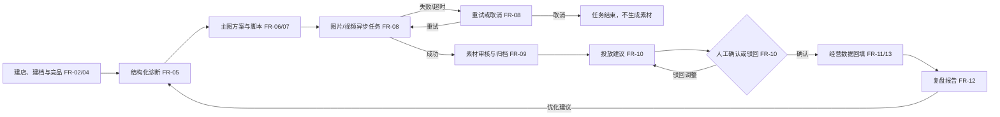
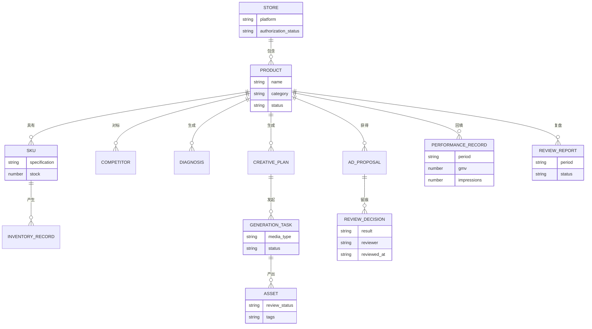

# 电商运营助手需求规格说明书（PRD）

| 项目 | 内容 |
| --- | --- |
| 文档名称 | 电商运营助手需求规格说明书 |
| 版本 | v0.3 |
| 作者角色 | 产品需求整理 |
| 日期 | 2026-10-15 |
| 状态 | 草稿，待用户评审 |
| 依据 | 用户提供的项目目标与 2.6.1—2.6.10 需求、参考项目结构 |

> **维护说明：** 本文保留 2026-10-15 的 PRD v0.3 基线及当时记录的评审状态。实际交付范围、已实现能力和与原计划的差异见[实现状态说明](../实现状态说明.md)；部署操作以仓库根目录的 [README.md](../../README.md) 为准。

本文件定义产品“要做什么”和“如何验收”。技术架构、接口与实现步骤另见[技术设计规格说明书](../architecture/SPEC.md)。

## 1. 产品目标与价值

**要解决的问题**：单品运营资料、内容制作、投放决策与经营结果分散，难以追踪一次运营行动从诊断到复盘的完整依据。

**目标用户**：电商运营人员、运营主管和系统管理员。

**建设目标与可验收结果**：

| 目标 | 成功标准 |
| --- | --- |
| 打通单品运营闭环 | 至少 1 个示例商品完成建档、竞品、诊断、创意、素材、投放建议、数据回填与复盘 8 个环节的演示。 |
| 让生成结果可用、可修改 | 每次创意生成至少 3 组主图方案和 3 套视频分镜脚本；诊断、方案和脚本均可在线编辑。 |
| 保持业务记录可追溯 | 演示链路中的诊断、创意、任务、素材、投放记录、经营数据和复盘报告均可从所属商品查看。 |
| 保持人工决策边界 | 所有投放建议的确认或驳回均记录处理人、时间与备注；外部广告计划自动创建和扣费次数为 0。 |

**交付范围**：可运行的运营大盘和商品工作台、后端服务与异步任务、示例店铺和商品数据、导入模板，以及至少一条完整演示链路。

## 2. 用户角色与权限矩阵

| 角色 | 职责 | 核心权限 |
| --- | --- | --- |
| 运营人员 | 执行单品日常运营 | 创建/编辑店铺与商品资料、SKU、竞品；发起诊断和生成任务；编辑 AI 草稿；审核素材；提交投放建议并标记风险等级；确认/驳回普通建议；录入/导入经营数据；查看复盘。 |
| 运营主管 | 审核高风险经营决策 | 拥有运营人员权限；确认/驳回高风险投放实验建议并留痕。 |
| 管理员 | 管理系统服务与账号配置 | 拥有主管权限；管理平台授权占位信息、模型服务配置、任务超时/重试/并发配置。 |

投放建议提交时由运营人员标记为“普通”或“高风险”：普通建议允许运营人员确认或驳回，高风险建议仅由运营主管或管理员确认或驳回。主管/管理员可将普通建议调整为高风险；风险等级及每次处理均需留痕。系统不自动执行外部投放。

## 3. 用户故事

| 编号 | 用户故事 | 对应需求 |
| --- | --- | --- |
| US-01 | 作为运营人员，我希望建立店铺、商品和 SKU 档案，以便在同一处维护单品基础资料。 | FR-02 |
| US-02 | 作为运营人员，我希望查看库存预警并补充竞品信息，以便发现备货和竞争风险。 | FR-03、FR-04 |
| US-03 | 作为运营人员，我希望得到可编辑的结构化商品诊断，以便确认目标客群与优化方向。 | FR-05 |
| US-04 | 作为运营人员，我希望得到多个主图方向和分镜脚本并修改内容，以便选出适合商品的创意。 | FR-06、FR-07 |
| US-05 | 作为运营人员，我希望提交图片/视频任务并处理失败或取消，以便掌握素材制作进度。 | FR-08 |
| US-06 | 作为运营人员，我希望审核、打标和归档生成素材，以便管理可用资产。 | FR-09 |
| US-07 | 作为运营主管，我希望按角色权限审核投放实验建议并留下处理记录，以便控制决策风险。 | FR-01、FR-10 |
| US-08 | 作为运营人员，我希望录入或导入经营数据，以便将真实结果与目标比较。 | FR-11、FR-13 |
| US-09 | 作为运营人员，我希望查看复盘报告并复用其中的优化建议，以便开始下一轮诊断。 | FR-12 |
| US-10 | 作为管理员，我希望维护模型和任务规则，以便服务可配置且异常可处理。 | FR-14 |
| US-11 | 作为运营人员，我希望从大盘找到商品和异常指标，以便快速进入对应工作台。 | FR-15 |
| US-12 | 作为运营人员，我希望在单品资料上发起 Agent 任务，并在需要人工审批时接手，以便让多步运营分析可追踪、可恢复。 | FR-20 |

## 4. 功能需求清单

优先级含义：P0 为首条完整演示链路所必需；P1 为后续阶段计划实现的增强；P2 为可选扩展。各阶段按用户审查结果逐步推进。

| 编号 | 模块 | 功能与边界 | 优先级 |
| --- | --- | --- | --- |
| FR-01 | 账号与权限 | 按运营人员、主管、管理员区分操作权限；关键审批记录人员和时间。 | P0 |
| FR-02 | 商品建档 | 创建店铺、商品、多规格 SKU，维护价格、品类、平台归属和基础信息。 | P0 |
| FR-03 | 库存 | 维护 SKU 库存及流水，展示库存预警。 | P0 |
| FR-04 | 竞品 | 录入竞品参数并与单品关联，展示对标信息；公开链接解析作为增强能力。 | P0 |
| FR-05 | 智能诊断 | 生成包含目标客群、价格带、卖点矩阵、转化卡点、优化方向的结构化诊断；可编辑、确认、归档。 | P0 |
| FR-06 | 主图创意 | 一次生成至少 3 组差异化方向，每组含版式、文案、卖点和视觉建议；可编辑、确认、归档。 | P0 |
| FR-07 | 视频脚本 | 一次生成至少 3 套分镜脚本，每套含 3 秒钩子、画面、口播和促单话术；可编辑、确认、归档。 | P0 |
| FR-08 | 异步生成 | 创建图片/视频任务，显示排队、运行、成功、失败、超时、取消状态及时间线；支持重试、取消和超时检测。 | P0 |
| FR-09 | 素材库 | 成功素材绑定商品及来源任务，支持版本查看、审核、打标和归档。 | P0 |
| FR-10 | 投放建议 | 生成包含人群、出价思路、素材组合和 A/B 实验的建议；运营人员标记普通/高风险，普通建议可由运营人员确认，高风险须由主管/管理员处理；所有决策留痕，不自动创建广告计划或扣费。 | P0 |
| FR-11 | 经营数据 | 按商品和周期录入目标与实际指标，至少含 GMV、曝光、点击率、转化率、ROI。 | P0 |
| FR-12 | 经营复盘 | 汇总单品全景、诊断、已采纳创意与素材、投放处理记录、目标与实际差异及行动建议；建议可转入下一轮诊断。 | P0 |
| FR-13 | 导入中心 | 下载商品、SKU 库存和经营数据模板；上传 Excel/CSV；字段映射、校验预览、错误行反馈和导入结果。 | P0 |
| FR-14 | 系统配置 | 管理文本、图片和视频服务参数；显示平台账号标识与脱敏授权状态；配置任务超时、重试和并发规则。 | P0 |
| FR-15 | 大盘与工作台 | 多店铺概览、商品检索、库存预警、快捷入口，以及同一商品下各环节联动展示。 | P0 |
| FR-16 | 竞品增强 | 解析公开商品链接，失败时允许人工补录；支持周期性竞品对比。 | P1 |
| FR-17 | 经营可视化 | 展示多店铺指标走势、单品目标与实际对比图表。 | P1 |
| FR-18 | 素材增强 | 为素材提供更细的版本比较和筛选能力。 | P2 |
| FR-19 | 示例扩展 | 在防晒衣场景之外增加无线充热销款防守场景。 | P2 |
| FR-20 | Agent 工作流 | 参考源码实现面向单品的 Agent 任务、运行记录、受控工具、人工审批与恢复；安排在首条单品闭环完成后的阶段。 | P1 |

**跨模块规则**：所有业务记录必须绑定所属商品；AI 结果不能覆盖已确认的人工修改版本；生成失败或超时不能进入“可用素材”；平台账号不存明文密码或 Cookie。

## 5. 非功能需求

下列数值为**建议验收目标，待用户确认**，用于把“可用、安全、稳定”转化为可测要求，不代表已有系统实测结果。

| 类别 | 建议验收目标 |
| --- | --- |
| 性能 | 在示例数据、10 名并发操作用户条件下，普通列表/详情操作的服务端 P95 响应时间不超过 2 秒；媒体生成时间单独展示，不计入该指标。 |
| 状态反馈 | 任务状态发生变化后，前端在 5 秒内展示新状态；任务超时后在 60 秒内标记并给出可处理提示。 |
| 安全与审计 | 平台明文密码与 Cookie 存储条数为 0；投放确认/驳回、素材审核、配置修改的操作记录覆盖率为 100%；密钥在界面和日志中的明文回显次数为 0。 |
| 可用性与恢复 | 服务重启后，已入队任务不应无记录地消失；异常任务在 2 分钟内进入可识别的失败、超时或待重试状态。 |
| 兼容性 | 桌面端 Chrome、Edge 各最近 2 个正式版本可完成完整演示流程。 |
| 导入质量 | 错误行应给出行号和原因；未经用户确认的校验失败数据写入条数为 0。 |

正式性能环境、业务规模和可用性目标待测试环境确定后确认，见第 11 节。

## 6. 核心业务流程图



运营大盘与商品工作台（FR-15）贯穿流程；库存（FR-03）、权限（FR-01）和系统配置（FR-14）提供支撑。图中的“确认”只记录人工决策，实际外部投放不由本系统执行。

## 7. 关键页面原型说明

以下是信息结构草图，视觉样式和交互细节后续再定。

**运营大盘与店铺概览（FR-15）**

```text
[店铺切换/搜索] [新建商品] [批量导入]
[店铺卡片] [商品总数] [动销率] [库存预警数]
[经营指标走势] [库存预警列表] [商品列表 → 商品工作台]
```

**商品智能运营工作台（FR-02—12、FR-15）**

```text
[商品/店铺/SKU 上下文] [当前环节状态]
[商品档案与竞品] [诊断：编辑/确认]
[主图方案/视频脚本：编辑/选定] [任务时间线/素材库：审核/归档]
[投放建议：确认/驳回] [经营数据：录入] [复盘报告/下一轮诊断]
```

**批量导入与数据中心（FR-13）**

```text
[选择数据类型] [下载模板] [拖拽 Excel/CSV]
[字段映射] [校验预览：成功行/错误行及原因]
[确认导入] [导入结果与历史]
```

**系统与服务配置（FR-14）**

```text
[文本/图片/视频服务参数] [连接测试与密钥脱敏]
[平台账号标识/授权状态] [任务超时/重试/并发规则]
```

## 8. 数据实体初稿

实体与关系用于确认产品归属，字段类型、主键方案和数据库结构留待 Spec。



诊断、创意、素材、投放、经营数据和报告还需通过商品标识直接检索；报告应区分录入事实、目标值与模型推断。AI 草稿及人工修改须保留可辨识的版本或操作记录。

## 9. 验收标准

每条 P0 需求均有对应的可测试条件。具体测试数据采用示例场景；真实图像/视频服务尚未配置时，任务应明确显示“未配置”，不能把模拟结果冒充真实生成素材。

| 需求 | 前置—操作—预期 |
| --- | --- |
| FR-01 | 给定运营人员账号，当尝试修改模型配置或审核高风险方案时，系统拒绝；给定主管/管理员账号审核高风险方案时，系统记录处理人和时间。 |
| FR-02 | 给定新店铺，当录入商品及至少 2 个不同规格 SKU 后，商品详情可按店铺显示各 SKU、价格与规格。 |
| FR-03 | 给定低于预警阈值的 SKU，当记录库存变化后，大盘或商品页出现预警，且库存流水可查询。 |
| FR-04 | 给定一个商品，当录入竞品名称、价格与核心参数后，商品页显示对应的竞品对比资料。 |
| FR-05 | 给定完整商品与竞品资料，当发起诊断后，结果包含指定 5 类字段；编辑并保存后再次打开，修改内容仍存在。 |
| FR-06 | 给定一份诊断，当生成主图创意后，至少出现 3 组含版式、文案、卖点、视觉建议的方向；可编辑、确认和归档。 |
| FR-07 | 给定一份诊断，当生成视频脚本后，至少出现 3 套含钩子、分镜画面、口播和促单话术的脚本；可编辑、确认和归档。 |
| FR-08 | 给定已选方案，当分别提交图片和视频任务后，能查询状态与时间线；失败任务可重试，未完成任务可取消，超时任务被标识为超时。 |
| FR-09 | 给定成功任务，当打开商品素材库后，可找到其素材和来源任务，并能审核、打标、归档；失败任务不产生可用素材。 |
| FR-10 | 给定普通建议，当运营人员确认或驳回后记录结果、人员、时间与备注；给定高风险建议，运营人员操作被拒绝，主管/管理员可处理；外部广告创建和扣费操作均为 0。 |
| FR-11 | 给定商品与经营周期，当录入目标值和实际 GMV、曝光、点击率、转化率、ROI 后，再次打开可查询原值。 |
| FR-12 | 给定完整单品数据，当生成复盘后，报告含单品全景、诊断、已选资产、投放记录、目标与实际比较、行动建议；选取建议可进入下一轮诊断。 |
| FR-13 | 给定商品、SKU 库存和经营数据模板，当上传 Excel/CSV 并映射字段后，可预览有效行及错误行；用户确认后仅导入有效行，错误行保留行号和原因。 |
| FR-14 | 给定管理员账号，当修改模型和任务规则后，页面显示已保存的非敏感配置；密钥不明文回显，平台账号仅显示标识和脱敏授权状态。 |
| FR-15 | 给定至少 1 个店铺和商品，当进入大盘并选择商品后，可看到概览、库存预警和商品入口；工作台各区展示同一商品的数据。 |

**端到端验收**：使用“夏季防晒衣冷启动测款”示例，从建档、竞品、诊断、3 组主图、3 套脚本、素材任务与审核、投放建议人工处理、7 天经营数据回填直到复盘报告，连续完成一次演示。

## 10. 依赖与约束

| 项目 | 约束或依赖 | 可控性 |
| --- | --- | --- |
| 参考项目 | 大致框架与主要业务链路作为学习和实现参考；允许少量优化。PRD 不直接锁定代码结构。 | 团队内 |
| 模型与媒体服务 | 文本与图片接入用户自行配置的 OpenAI 官方 API Key；图片需使用图像生成模型接口，实际可用性取决于账号权限和额度。视频沿用参考项目的即梦或 DashScope 接入边界，待用户配置对应服务密钥。 | 外部协调 |
| 平台数据 | 首期按参考项目维护平台标识、商品映射和脱敏授权状态，以人工录入/导入为主要数据入口；真实平台授权与自动拉取数据不属于首期。 | 团队内 |
| Agent 范围 | 参考源码确有多 Agent 平台；本项目计划在首条单品闭环完成后分阶段实现，单独验收任务、审批与恢复。 | 团队内 |
| 投放边界 | 建议供人工决策；不调用外部广告接口创建计划或扣费。 | 团队内 |
| 数据与保密 | 不保存平台明文密码、Cookie；模型密钥不在界面与日志明文回显；示例数据与真实经营数据分开标识。 | 团队内 |
| 命名与来源 | 新项目界面、包名、示例账号与文档使用通用命名，不沿用参考项目机构、作者或课堂路径名称；应保留适用的原始许可和来源声明。 | 团队内 |

## 11. 待确认问题

| 编号 | 问题 | 建议确认方 |
| --- | --- | --- |
| Q1 | 视频服务最终选即梦还是 DashScope？对应账号与密钥何时可用于真实生成验收？ | 项目负责人 |
| Q2 | 第 5 节的并发、响应、恢复和浏览器指标是否适合作为首期验收目标？测试环境和数据规模如何界定？ | 项目负责人 / 技术负责人 |
| Q3 | Agent 阶段是否需要完全覆盖参考源码中的对话、记忆、工作流注册与评估功能？可在完成 P0 闭环后逐项审查。 | 项目负责人 |
